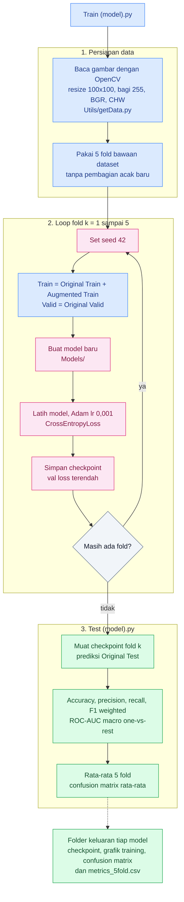
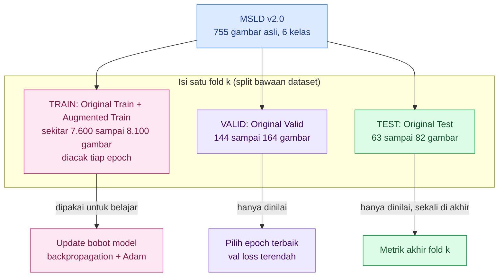
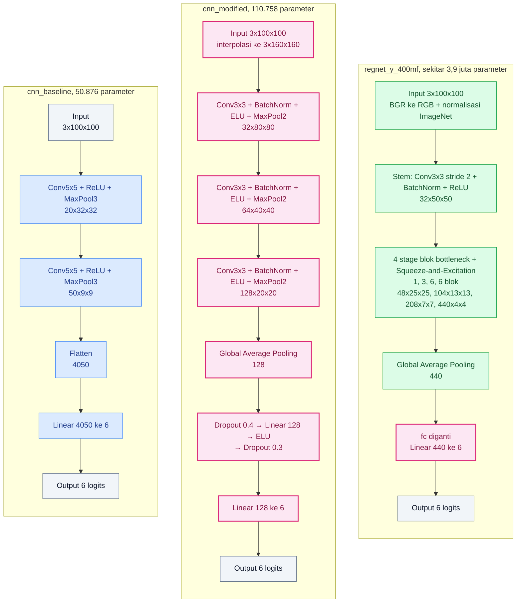

## Cara Menjalankan

1. Clone repositori, buat virtual environment, lalu instal dependensi. Versi yang diuji tercantum pada
   `requirements.txt` (Python lokal 3.14.4). Untuk GPU, gunakan pasangan torch/torchvision yang sesuai petunjuk resmi
   PyTorch.

```powershell
git clone https://github.com/filzahghaniyyah/mpox-skin-lesion-classification.git
cd mpox-skin-lesion-classification
python -m venv .venv
.\.venv\Scripts\python.exe -m pip install -r requirements.txt
```

2. Unduh dan ekstrak dataset Kaggle secara lokal dengan struktur berikut.

```text
DATA_ROOT/
├── Original Images/Original Images/FOLDS/
│   ├── fold1/Train|Valid|Test/<kelas>/
│   └── ... fold5/
└── Augmented Images/Augmented Images/FOLDS_AUG/
    ├── fold1_AUG/Train/<kelas>/
    └── ... fold5_AUG/
```

3. Jalankan training lalu testing. Semua perintah berjalan dari root repositori.

```powershell
# CNN baseline dan RegNet membaca dataset dari root repositori.
.\.venv\Scripts\python.exe "Train (CNN).py"
.\.venv\Scripts\python.exe "Test (CNN).py"
.\.venv\Scripts\python.exe "Train (RegNet).py"
.\.venv\Scripts\python.exe "Test (RegNet).py"

# CNN modifikasi juga menerima lokasi dataset melalui --data-root.
.\.venv\Scripts\python.exe "Train (CNN modified).py" --data-root "D:\data\msld"
.\.venv\Scripts\python.exe "Test (CNN modified).py" --data-root "D:\data\msld"
```

CNN baseline dan RegNet mencari `Original Images` dan `Augmented Images` di sebelah skrip. CNN baseline berjalan di CPU. RegNet memakai DirectML jika `torch-directml` tersedia dan memakai CPU pada instalasi standar. Untuk CNN modifikasi, `--data-root`, `--device`, `--batch-size` dan `--output-root` berlaku saat training maupun testing. `--epochs`, `--learning-rate` dan `--seed` berlaku saat training, sedangkan `--checkpoint-root` berlaku saat testing.

| Model | Lokasi checkpoint, metrik, dan grafik yang baru dibuat |
| --- | --- |
| CNN baseline | Root repositori, di sebelah `Train (CNN).py` |
| CNN modifikasi | `outputs/model 2 (CNN modified)/` secara default |
| RegNetY-400MF | `outputs/model 3 (RegNet)/` |

## Struktur

```text
Models/
├── CNN.py                  model 1: CNN baseline
├── CNN_modified.py         model 2: CNN modifikasi
└── RegNet.py               model 3: RegNetY-400MF pretrained
Utils/
├── getData.py              baca gambar OpenCV, resize 100 × 100, label one-hot
├── runtime.py              opsi command line, device, simpan konfigurasi dan history
└── reporting.py            ekspor metrik per kelas
Train (CNN).py              training 5 fold CNN baseline
Train (CNN modified).py     training 5 fold CNN modifikasi
Train (RegNet).py           training 5 fold RegNet
Test (*.py)                 evaluasi 5 fold: metrik, confusion matrix
scripts/                    pengumpulan hasil dan pemeriksaan isi repositori
results/initial/            grafik dan CSV pada subfolder cnn, cnn_modified, dan regnet
results/                    distribusi dataset dan grafik perbandingan tiga model
```

## Alur Kerja

### Alur kerja keseluruhan



### Pembagian data 5-fold



### Arsitektur model



## Metode

- **Pembagian data:** memakai 5 fold bawaan dataset. Training memakai **Original Train + Augmented Train** pada fold
  yang sama, validasi memakai **Original Valid** untuk memilih checkpoint dengan validation loss terendah, dan pengujian
  memakai **Original Test**. Model dan optimizer diinisialisasi ulang untuk setiap fold.
- **Preprocessing:** OpenCV membaca citra, resize ke 100 × 100, intensitas dibagi 255, susunan kanal diubah menjadi CHW.
  Urutan warna tetap BGR. CNN modifikasi memperbesar input ke 160 × 160 di dalam `forward()`. RegNet menukar kanal
  BGR → RGB dan menerapkan normalisasi mean/std ImageNet di dalam `forward()` agar sesuai bobot pretrained.
- **Loss / optimizer:** semua model menghasilkan enam logits, dilatih dengan `CrossEntropyLoss` dan Adam.
- **Evaluasi:** accuracy, precision, recall, F1 (weighted), ROC-AUC (macro one-vs-rest dari `softmax(logits)`), dan
  confusion matrix yang dinormalisasi per baris. Semua metrik dirata-ratakan dari 5 fold.

Tabel berikut menunjukkan pengaturan bawaan skrip yang dipakai untuk hasil di README.

| Pengaturan | CNN baseline | CNN modifikasi | RegNetY-400MF |
| --- | --- | --- | --- |
| Epoch maksimum | 100 | 30 | 10 |
| Batch size | 32 | 32 | 16 |
| Optimizer / learning rate | Adam / 0,001 | Adam / 0,001 | Adam / 0,001 |
| Seed per fold | 42 | 42 | 42 |
| Pemilihan checkpoint | Valid loss minimum | Valid loss minimum | Valid loss minimum |
| Early stopping | Tidak | Patience 5 | Tidak |
| Scheduler | Tidak | ReduceLROnPlateau, factor 0,5, patience 2 | Tidak |
| Inisialisasi | Acak | Acak | Pretrained ImageNet (`IMAGENET1K_V2`), seluruh layer di-fine-tune |

Perbandingan ini menilai konfigurasi eksperimen secara keseluruhan. Perbedaan hasil tidak dapat langsung dianggap
sebagai pengaruh satu perubahan arsitektur karena ukuran input, batch size, lama training, inisialisasi, dan strategi
optimasi juga berbeda.

## Hasil

### Rata-rata lima fold

| Model | Accuracy | Precision weighted | Recall weighted | F1 weighted | ROC-AUC macro OvR |
| --- | ---: | ---: | ---: | ---: | ---: |
| CNN baseline | 49,37 ± 3,35% | 43,79 ± 4,89% | 49,37 ± 3,35% | 43,19 ± 4,26% | 0,7432 ± 0,0474 |
| CNN modifikasi | 51,97 ± 3,57% | 48,24 ± 7,86% | 51,97 ± 3,57% | 47,25 ± 4,52% | 0,7869 ± 0,0480 |
| RegNetY-400MF | 75,85 ± 5,80% | 76,97 ± 6,60% | 75,85 ± 5,80% | 75,11 ± 5,90% | 0,9335 ± 0,0110 |

Rata-rata dan simpangan baku sampel dihitung dari lima baris fold pada masing-masing CSV. RegNetY-400MF memperoleh akurasi tertinggi pada setiap fold. [Pembahasan hasil tiga model](README.md#hasil-rata-rata-evaluasi-dari-kelima-fold)

### Hasil per fold

| Model | Fold | Accuracy | Precision weighted | Recall weighted | F1 weighted | ROC-AUC macro OvR |
| --- | ---: | ---: | ---: | ---: | ---: | ---: |
| CNN baseline | 1 | 51,35% | 42,32% | 51,35% | 42,45% | 0,7606 |
| CNN baseline | 2 | 50,00% | 40,71% | 50,00% | 41,62% | 0,6790 |
| CNN baseline | 3 | 43,75% | 38,15% | 43,75% | 38,49% | 0,7082 |
| CNN baseline | 4 | 49,38% | 48,43% | 49,38% | 43,33% | 0,7843 |
| CNN baseline | 5 | 52,38% | 49,34% | 52,38% | 50,07% | 0,7838 |
| CNN modifikasi | 1 | 47,30% | 35,31% | 47,30% | 40,28% | 0,7980 |
| CNN modifikasi | 2 | 56,10% | 53,81% | 56,10% | 51,66% | 0,8370 |
| CNN modifikasi | 3 | 53,13% | 50,85% | 53,13% | 49,88% | 0,7565 |
| CNN modifikasi | 4 | 49,38% | 46,68% | 49,38% | 45,41% | 0,7205 |
| CNN modifikasi | 5 | 53,97% | 54,57% | 53,97% | 49,04% | 0,8222 |
| RegNetY-400MF | 1 | 74,32% | 76,72% | 74,32% | 73,55% | 0,9234 |
| RegNetY-400MF | 2 | 69,51% | 68,82% | 69,51% | 68,68% | 0,9207 |
| RegNetY-400MF | 3 | 81,25% | 81,95% | 81,25% | 80,82% | 0,9374 |
| RegNetY-400MF | 4 | 71,60% | 72,47% | 71,60% | 70,74% | 0,9396 |
| RegNetY-400MF | 5 | 82,54% | 84,87% | 82,54% | 81,74% | 0,9464 |

Berkas evaluasi Original Test tersedia untuk ketiga model. [CNN baseline](results/initial/cnn/metrics_5fold.csv) · [CNN modifikasi](results/initial/cnn_modified/metrics_5fold.csv) · [RegNetY-400MF](results/initial/regnet/metrics_5fold.csv)
