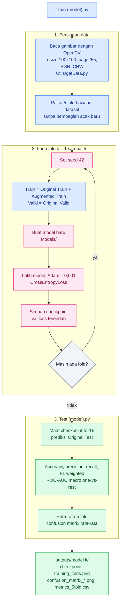
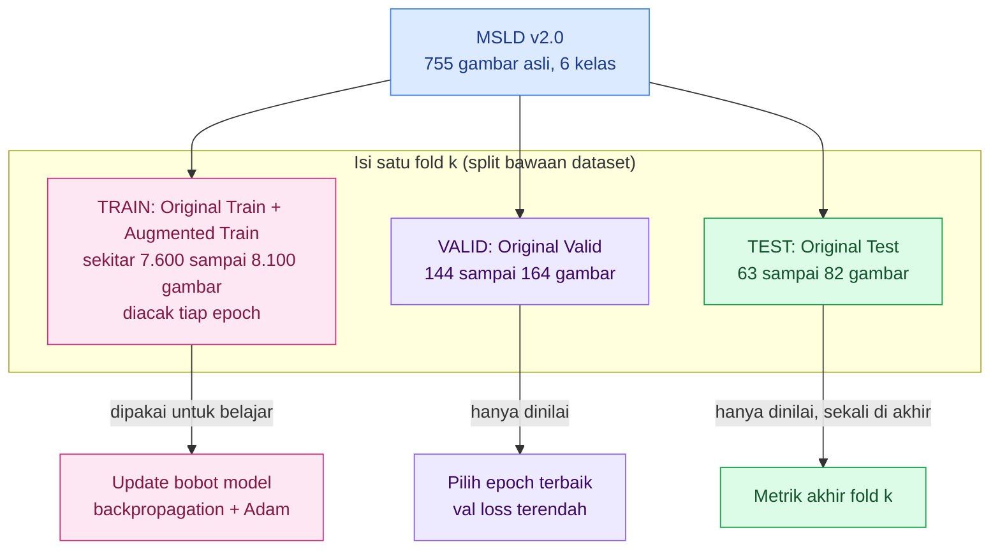
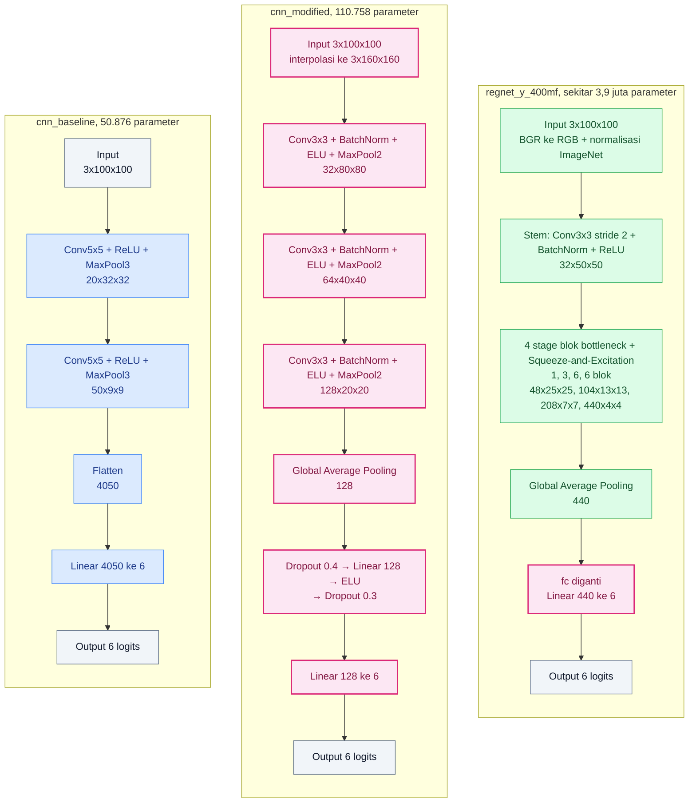

## Cara Menjalankan

1. Clone repositori, buat virtual environment, lalu instal dependensi. Versi yang diuji tercantum pada
   `requirements.txt` (Python lokal 3.14.4). Untuk GPU, gunakan pasangan torch/torchvision yang sesuai petunjuk resmi
   PyTorch.

```powershell
git clone https://github.com/filzahghaniyyah/mpox-skin-lesion-classification.git
cd mpox-skin-lesion-classification
python -m venv .venv
.\.venv\Scripts\python.exe -m pip install -r requirements.txt
```

2. Unduh dan ekstrak dataset Kaggle secara lokal dengan struktur berikut.

```text
DATA_ROOT/
├── Original Images/Original Images/FOLDS/
│   ├── fold1/Train|Valid|Test/<kelas>/
│   └── ... fold5/
└── Augmented Images/Augmented Images/FOLDS_AUG/
    ├── fold1_AUG/Train/<kelas>/
    └── ... fold5_AUG/
```

3. Jalankan training lalu testing. Semua perintah berjalan dari root repositori.

```powershell
# CNN baseline dan CNN modifikasi: --data-root menunjuk ke DATA_ROOT, --device cpu adalah default
.\.venv\Scripts\python.exe "Train (CNN).py" --data-root "D:\data\msld"
.\.venv\Scripts\python.exe "Test (CNN).py" --data-root "D:\data\msld"

.\.venv\Scripts\python.exe "Train (CNN modified).py" --data-root "D:\data\msld"
.\.venv\Scripts\python.exe "Test (CNN modified).py" --data-root "D:\data\msld"

# RegNet: folder dataset diletakkan langsung di root repositori (DATA_ROOT = root repositori)
.\.venv\Scripts\python.exe "Train (RegNet).py"
.\.venv\Scripts\python.exe "Test (RegNet).py"
```

Untuk CNN, `--epochs`, `--batch-size`, `--learning-rate`, `--seed`, `--output-root`, dan `--checkpoint-root` dapat
diatur dari command line. Script RegNet memakai pengaturan tetap di dalam file dan otomatis memakai GPU lewat
`torch-directml` bila paket itu terpasang; jika tidak, berjalan di CPU.

Checkpoint terbaik dan output baru disimpan lokal di `outputs/model 1 (CNN)`, `outputs/model 2 (CNN modified)`, dan
`outputs/model 3 (RegNet)`. Folder ini diabaikan Git.

## Struktur

```text
Models/
├── CNN.py                  model 1: CNN baseline
├── CNN_modified.py         model 2: CNN modifikasi
└── RegNet.py               model 3: RegNetY-400MF pretrained
Utils/
├── getData.py              baca gambar OpenCV, resize 100 × 100, label one-hot
├── runtime.py              opsi command line, device, simpan konfigurasi dan history
└── reporting.py            ekspor metrik per kelas
Train (CNN).py              training 5 fold CNN baseline
Train (CNN modified).py     training 5 fold CNN modifikasi
Train (RegNet).py           training 5 fold RegNet
Test (*.py)                 evaluasi 5 fold: metrik, confusion matrix
scripts/                    pengumpulan hasil dan pemeriksaan isi repositori
results/initial/            grafik/CSV eksperimen awal dua CNN
results/regnet/             grafik/CSV hasil RegNet
results/                    distribusi dataset dan grafik perbandingan
docs/                       riwayat eksperimen dan langkah melengkapi hasil
assets/                     banner dan diagram arsitektur
```

## Alur Kerja

### Alur kerja keseluruhan



### Pembagian data 5-fold



### Arsitektur model



Diagram detail per layer: [architecture-pink-blue.png](assets/architecture-pink-blue.png). Diagram tersebut masih
menggambarkan Swin-Tiny sebagai model 3 dan perlu diperbarui ke RegNet.

## Metode

- **Pembagian data:** memakai 5 fold bawaan dataset. Training memakai **Original Train + Augmented Train** pada fold
  yang sama, validasi memakai **Original Valid** untuk memilih checkpoint dengan validation loss terendah, dan pengujian
  memakai **Original Test**. Model dan optimizer diinisialisasi ulang untuk setiap fold.
- **Preprocessing:** OpenCV membaca citra, resize ke 100 × 100, intensitas dibagi 255, susunan kanal diubah menjadi CHW.
  Urutan warna tetap BGR. CNN modifikasi memperbesar input ke 160 × 160 di dalam `forward()`. RegNet menukar kanal
  BGR → RGB dan menerapkan normalisasi mean/std ImageNet di dalam `forward()` agar sesuai bobot pretrained.
- **Loss / optimizer:** semua model menghasilkan enam logits, dilatih dengan `CrossEntropyLoss` dan Adam.
- **Evaluasi:** accuracy, precision, recall, F1 (weighted), ROC-AUC (macro one-vs-rest dari `softmax(logits)`), dan
  confusion matrix yang dinormalisasi per baris. Semua metrik dirata-ratakan dari 5 fold.

| Pengaturan | CNN baseline | CNN modifikasi | RegNetY-400MF |
| --- | --- | --- | --- |
| Epoch maksimum | 10 | 30 | 10 |
| Batch size | 32 | 32 | 16 |
| Optimizer / learning rate | Adam / 0,001 | Adam / 0,001 | Adam / 0,001 |
| Seed per fold | 42 | 42 | 42 |
| Pemilihan checkpoint | Valid loss minimum | Valid loss minimum | Valid loss minimum |
| Early stopping | Tidak | Patience 5 | Tidak |
| Scheduler | Tidak | ReduceLROnPlateau, factor 0,5, patience 2 | Tidak |
| Inisialisasi | Acak | Acak | Pretrained ImageNet (`IMAGENET1K_V2`), seluruh layer di-fine-tune |

Perbandingan ini menilai konfigurasi eksperimen secara keseluruhan. Perbedaan hasil tidak dapat langsung dianggap
sebagai pengaruh satu perubahan arsitektur karena ukuran input, batch size, lama training, inisialisasi, dan strategi
optimasi juga berbeda.

## Hasil

### Rata-rata lima fold

| Model | Accuracy | Precision weighted | Recall weighted | F1 weighted | ROC-AUC macro OvR |
| --- | --- | --- | --- | --- | --- |
| CNN baseline | 43,47 ± 9,72% | 35,57 ± 5,22% | 43,47 ± 9,72% | 36,37 ± 8,08% | 0,7408 ± 0,0384 |
| CNN modifikasi | 51,81 ± 5,48% | 43,49 ± 9,81% | 51,81 ± 5,48% | 44,30 ± 7,74% | 0,7607 ± 0,0350 |
| RegNetY-400MF | 75,85 ± 5,80% | 76,97 ± 6,60% | 75,85 ± 5,80% | 75,11 ± 5,90% | 0,9335 ± 0,0110 |

Nilai ditampilkan sebagai **mean ± standar deviasi sampel** (`ddof=1`) dari lima fold. RegNet unggul **24,04 poin
persentase** pada accuracy dan **30,81 poin persentase** pada F1 weighted dari CNN modifikasi. Keunggulan ini tidak
dapat dikaitkan hanya pada arsitektur, karena RegNet juga memakai bobot pretrained ImageNet sedangkan kedua CNN dilatih
dari nol.

### Hasil per fold

| Model | Fold | Accuracy | Precision weighted | Recall weighted | F1 weighted | ROC-AUC macro OvR |
| --- | --- | --- | --- | --- | --- | --- |
| CNN baseline | 1 | 52,70% | 41,00% | 52,70% | 43,32% | 0,7791 |
| CNN baseline | 2 | 46,34% | 36,47% | 46,34% | 39,10% | 0,7105 |
| CNN baseline | 3 | 46,88% | 39,43% | 46,88% | 41,04% | 0,6952 |
| CNN baseline | 4 | 44,44% | 32,94% | 44,44% | 35,56% | 0,7788 |
| CNN baseline | 5 | 26,98% | 28,02% | 26,98% | 22,85% | 0,7406 |
| CNN modifikasi | 1 | 44,59% | 26,60% | 44,59% | 33,32% | 0,7394 |
| CNN modifikasi | 2 | 56,10% | 44,74% | 56,10% | 49,43% | 0,7819 |
| CNN modifikasi | 3 | 57,81% | 51,90% | 57,81% | 53,46% | 0,7359 |
| CNN modifikasi | 4 | 48,15% | 46,37% | 48,15% | 41,32% | 0,7339 |
| CNN modifikasi | 5 | 52,38% | 47,84% | 52,38% | 43,98% | 0,8124 |
| RegNetY-400MF | 1 | 74,32% | 76,72% | 74,32% | 73,55% | 0,9234 |
| RegNetY-400MF | 2 | 69,51% | 68,82% | 69,51% | 68,68% | 0,9207 |
| RegNetY-400MF | 3 | 81,25% | 81,95% | 81,25% | 80,82% | 0,9374 |
| RegNetY-400MF | 4 | 71,60% | 72,47% | 71,60% | 70,74% | 0,9396 |
| RegNetY-400MF | 5 | 82,54% | 84,87% | 82,54% | 81,74% | 0,9464 |

CNN baseline tertinggi pada fold 1 (52,70%) dan terendah pada fold 5 (26,98%). CNN modifikasi tertinggi pada fold 3
(57,81%) dan terendah pada fold 1 (44,59%). RegNet tertinggi pada fold 5 (82,54%) dan terendah pada fold 2 (69,51%).
Ukuran Test hanya 63 sampai 82 gambar per fold, sehingga skor cukup sensitif terhadap pembagian data.

CSV asli: [CNN baseline](results/initial/cnn/metrics_5fold.csv),
[CNN modifikasi](results/initial/cnn_modified/metrics_5fold.csv), dan
[RegNet](results/regnet/metrics_5fold.csv).
