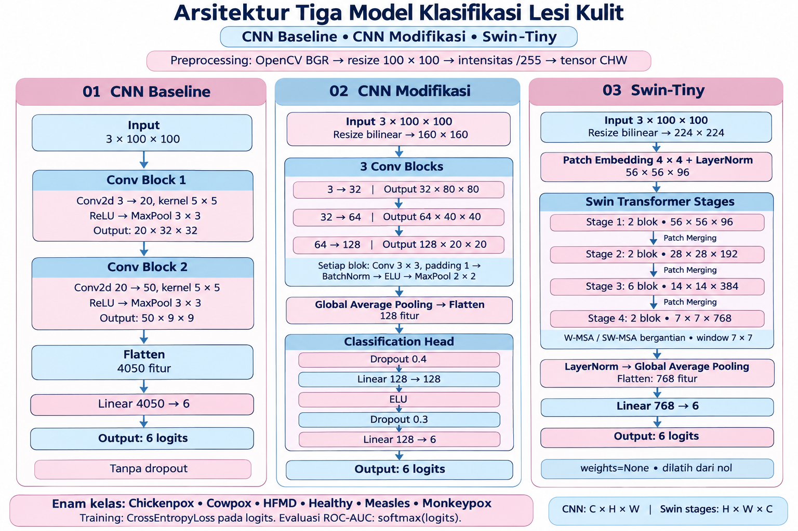
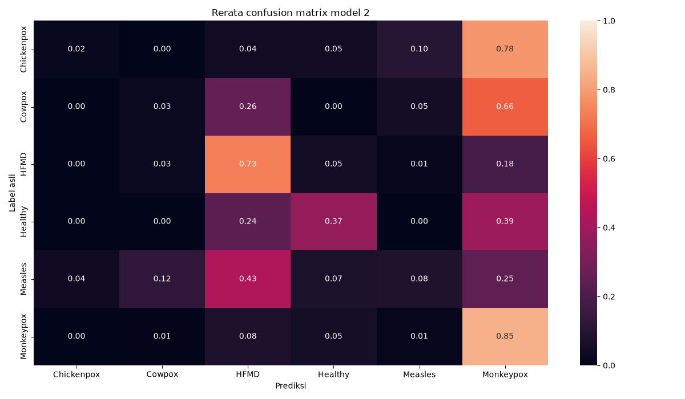
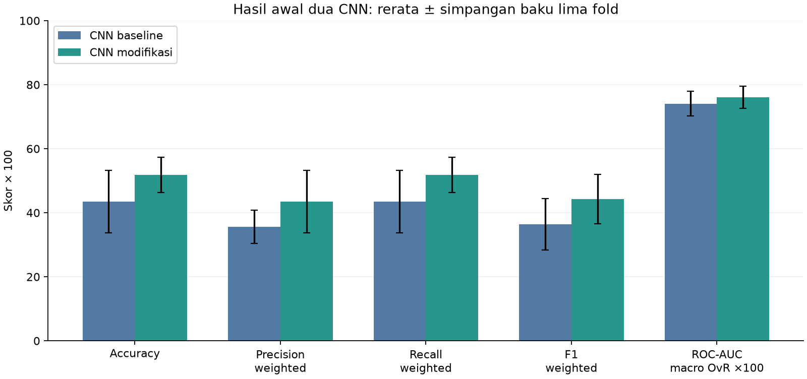
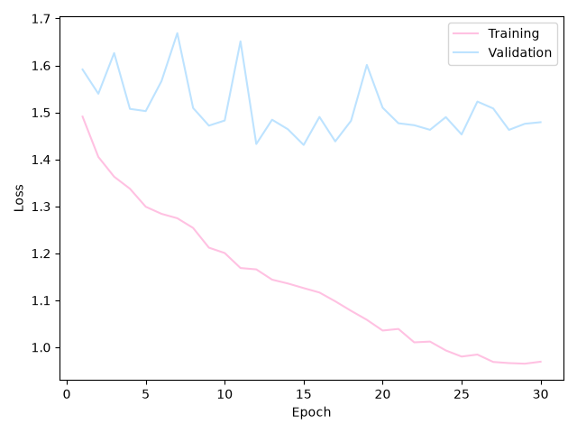

# Klasifikasi Citra Lesi Kulit dengan CNN dan Swin Transformer

Studi kasus mata kuliah **Infrastruktur dan Platform untuk Sains Data** menggunakan Mpox Skin Lesion Dataset v2.0 (MSLD v2.0). Proyek ini membandingkan CNN baseline dari materi, CNN dengan arsitektur yang dimodifikasi, dan Swin-Tiny untuk mengklasifikasikan enam kelas citra kulit.

**Status per 17 November 2026:** hasil lima fold untuk dua CNN sudah tersedia dan diverifikasi ulang dari checkpoint lokal. Swin sedang dijalankan oleh penulis; hasilnya belum dimasukkan. Repositori ini belum menyatakan eksperimen tiga model selesai.

**Catatan hasil awal:** kode yang menyertai eksperimen CNN modifikasi menggunakan Augmented Train saja. Versi training di repositori ini telah diperbaiki menjadi Original Train + Augmented Train sesuai tugas. Angka pada `results/initial/` tetap merupakan hasil lama, bukan hasil pelatihan ulang kode yang diperbaiki. Lihat [riwayat dan batas interpretasi](docs/experiment_history.md).

## Tujuan dan alasan pemilihan model

Tujuan eksperimen adalah menilai kemampuan model membedakan Chickenpox, Cowpox, HFMD, Healthy, Measles, dan Monkeypox pada dataset yang ditentukan. CNN baseline menjadi pembanding terhadap implementasi materi. CNN modifikasi menguji kombinasi tiga blok konvolusi, BatchNorm, ELU, pooling global, dan dropout. Swin-Tiny memberi pembanding berbasis Transformer dengan attention pada jendela lokal yang bergeser.

Perbandingan ini menilai konfigurasi eksperimen secara keseluruhan. Perbedaan hasil tidak dapat langsung dianggap sebagai pengaruh satu perubahan arsitektur karena ukuran input, batch size, lama training, dan strategi optimasi juga berbeda.

## Dataset dan aturan pembagian

Sumber data: [Mpox Skin Lesion Dataset v2.0 di Kaggle](https://www.kaggle.com/datasets/joydippaul/mpox-skin-lesion-dataset-version-20-msld-v20/data).

- Training menggunakan **Original Train + Augmented Train pada fold yang sama**.
- Validasi menggunakan **Original Valid** untuk memilih checkpoint dengan validation loss terendah.
- Pengujian menggunakan **Original Test** dari fold yang sesuai, setelah pemilihan checkpoint.
- Model dan optimizer diinisialisasi ulang untuk masing-masing dari lima fold. Split bawaan dataset dipertahankan; tidak membuat pembagian acak baru.
- Dataset, arsip dataset, dan bobot model tidak diunggah ke repositori.

## Arsitektur dan metode



Diagram mengikuti urutan layer pada source proyek. Notasi ukuran CNN adalah C × H × W; notasi stage Swin adalah H × W × C. [Unduh PNG diagram](assets/architecture-pink-blue.png).

| Komponen | CNN baseline | CNN modifikasi | Swin-Tiny |
|---|---|---|---|
| Implementasi | [CNN.py](Models/CNN.py) | [CNN_modified.py](Models/CNN_modified.py) | [SwinModel.py](Models/SwinModel.py) |
| Ukuran internal | 100 × 100 | 160 × 160 setelah interpolasi dari 100 × 100 | 224 × 224 setelah interpolasi dari 100 × 100 |
| Ekstraksi fitur | Conv 3→20→50, kernel 5, ReLU, MaxPool 3 | Conv 3→32→64→128, kernel 3, BatchNorm, ELU, MaxPool 2 | Hierarchical shifted-window self-attention |
| Kepala klasifikasi | Flatten 4050 → Linear 6 | Global Average Pooling → Dense 128 → Linear 6 | Kepala Swin diganti Linear 768 → 6 |
| Dropout eksplisit CNN | Tidak ada | 0,4 dan 0,3 | Mengikuti implementasi Swin torchvision |
| Parameter terlatih | 50.876 | 110.758 | 27.523.968 |
| Inisialisasi | Acak | Acak | `weights=None`, tanpa bobot pretrained |

CNN mempelajari pola lokal melalui filter konvolusi. BatchNorm menormalkan aktivasi dalam proses training; ELU menjadi alternatif ReLU, sedangkan dropout dan global average pooling digunakan dalam CNN modifikasi. Swin mempelajari hubungan antarfitur dalam jendela dan menghubungkan jendela melalui pergeseran. Dasar Swin: [Liu dkk., 2021](https://arxiv.org/abs/2103.14030); implementasi: [torchvision swin_t](https://docs.pytorch.org/vision/stable/models/generated/torchvision.models.swin_t.html).

Semua model menghasilkan enam **logits** dan dilatih dengan `CrossEntropyLoss`. Label loader berbentuk one-hot float; indeks kelas diperoleh dengan `argmax` saat evaluasi. `softmax(logits)` hanya digunakan untuk probabilitas ROC-AUC. Precision, recall, dan F1 memakai rata-rata **weighted**; ROC-AUC memakai **macro one-vs-rest**. Semua metrik dirata-ratakan antar lima fold dengan bobot fold sama. Confusion matrix dinormalisasi per baris pada setiap fold, kemudian dirata-ratakan. [Definisi ROC-AUC multikelas](https://scikit-learn.org/stable/modules/generated/sklearn.metrics.roc_auc_score.html).

### Konfigurasi default kode training saat ini

| Pengaturan | CNN baseline | CNN modifikasi | Swin-Tiny |
|---|---|---|---|
| Epoch maksimum | 10 | 30 | 10 |
| Batch size | 32 | 32 | 8 |
| Optimizer / learning rate | Adam / 0,001 | Adam / 0,001 | Adam / 0,001 |
| Seed per fold | 42 | 42 | 42 |
| Pemilihan checkpoint | Valid loss minimum | Valid loss minimum | Valid loss minimum |
| Early stopping | Tidak | Patience 5 | Tidak |
| Scheduler | Tidak | ReduceLROnPlateau, factor 0,5, patience 2 | Tidak |

Konfigurasi di atas adalah default kode yang dibagikan, bukan bukti bahwa semua hasil lama menggunakan kode ini. Run baru menyimpan `run_config.json` dan `history_fold*.csv`. Untuk perbandingan arsitektur yang lebih terkontrol, samakan kebijakan data dan anggaran training, lalu dokumentasikan setiap perbedaan yang masih diperlukan.

## Jawaban tujuh pertanyaan LMS

### 1. Bagaimana karakteristik distribusi data pada setiap kelas?

Hitungan diperoleh langsung dari folder lokal, bukan dari perkiraan. Dalam satu fold lengkap terdapat **755 citra original** pada gabungan Train, Valid, dan Test. Tabel menggunakan fold 1 sebagai acuan; kelima fold memiliki total per kelas yang sama. Angka lima fold tidak dijumlahkan sebagai jumlah citra unik karena fold merupakan pembagian ulang koleksi yang sama.

| Kelas | Citra original dalam satu fold lengkap | Proporsi |
| --- | --- | --- |
| Chickenpox | 75 | 9.93% |
| Cowpox | 66 | 8.74% |
| HFMD | 161 | 21.32% |
| Healthy | 114 | 15.10% |
| Measles | 55 | 7.28% |
| Monkeypox | 284 | 37.62% |

Monkeypox merupakan kelas terbesar, sedangkan Measles paling sedikit, dengan rasio sekitar **5,16 : 1**. Data tidak seimbang. Jumlah file Augmented Train pada setiap kelas adalah 14 kali jumlah Original Train, sehingga distribusi proporsi kelas tetap tidak seimbang. Jumlah file bukan jumlah pasien.


| Fold | Original Train | Augmented Train | Train gabungan | Valid | Test |
| --- | --- | --- | --- | --- | --- |
| 1 | 537 | 7518 | 8055 | 144 | 74 |
| 2 | 509 | 7126 | 7635 | 164 | 82 |
| 3 | 538 | 7532 | 8070 | 153 | 64 |
| 4 | 524 | 7336 | 7860 | 150 | 81 |
| 5 | 538 | 7532 | 8070 | 154 | 63 |

Tabel lengkap per kelas dan split tersedia di [dataset_distribution.csv](results/dataset_distribution.csv). Penjumlahan Original dan Augmented Train mengikuti ketentuan tugas; transformasi augmentasi spesifik tidak direkonstruksi karena proyek menggunakan file augmentasi yang disediakan dataset.

### 2. Preprocessing apa yang digunakan dan bagaimana pengaruhnya terhadap hasil klasifikasi?

Loader membaca citra dengan OpenCV, melakukan resize menjadi **100 × 100**, membagi intensitas dengan **255**, mengubah susunan kanal menjadi **CHW**, dan mengonversinya ke tensor `float32`. Urutan warna tetap **BGR**, sesuai kode dan checkpoint awal; tidak ada konversi RGB atau normalisasi ImageNet. CNN modifikasi dan Swin kemudian memperbesar tensor dengan interpolasi bilinear di dalam `forward()`.

Resize menyeragamkan dimensi input dan pembagian 255 menyetarakan skala intensitas. Namun, detail lesi yang hilang ketika diperkecil ke 100 × 100 tidak kembali hanya dengan diperbesar ke 160 atau 224. Tidak ada eksperimen ablation dengan model dan pengaturan identik, sehingga besar pengaruh preprocessing terhadap skor belum dapat diukur secara terpisah. Peningkatan CNN modifikasi tidak boleh diklaim semata-mata akibat resize, ELU, atau dropout.

### 3. Apakah model mampu mengklasifikasikan keenam kelas dengan baik?

**Belum secara merata.** CNN baseline memperoleh accuracy rata-rata **43,47%** dan CNN modifikasi **51,81%**. Recall per kelas menunjukkan kemampuan lebih baik pada HFMD dan Monkeypox daripada Chickenpox, Cowpox, dan Measles. Skor weighted dipengaruhi jumlah sampel kelas; karena itu confusion matrix dan recall setiap kelas juga diperiksa.

| Kelas | Recall rata-rata CNN | Recall rata-rata CNN modifikasi |
| --- | --- | --- |
| Chickenpox | 0.00% | 2.22% |
| Cowpox | 26.43% | 2.86% |
| HFMD | 51.08% | 73.08% |
| Healthy | 39.27% | 37.29% |
| Measles | 0.00% | 8.00% |
| Monkeypox | 70.61% | 84.88% |

Recall di tabel adalah rerata lima recall per fold, bukan recall dari satu confusion matrix gabungan. Swin belum dapat dinilai sebelum pengujian lima fold selesai.

### 4. Kelas apa yang paling sering mengalami kesalahan klasifikasi?

Pada CNN baseline, **Chickenpox dan Measles memiliki tingkat kesalahan rata-rata 100%** (recall 0%). Chickenpox paling sering diprediksi sebagai Monkeypox, dengan proporsi rata-rata 82,22% dari Chickenpox di masing-masing fold. Measles juga paling sering menjadi Monkeypox (66,33%). Jika memakai jumlah kemunculan pada seluruh Test fold, Chickenpox memiliki 42 kesalahan dari 42 kemunculan, paling banyak pada baseline.

Pada CNN modifikasi, tingkat kesalahan rata-rata tertinggi adalah **Chickenpox 97,78%**, diikuti **Cowpox 97,14%** dan **Measles 92,00%**. Chickenpox paling sering menjadi Monkeypox (78,43%); Cowpox juga paling sering menjadi Monkeypox (66,10%). Chickenpox salah pada 41 dari 42 kemunculan Test. Kemunculan antar fold tidak diperlakukan sebagai pasien atau citra unik.

Bukti numerik: [per kelas CNN](results/initial/cnn/per_class_summary.csv), [per kelas CNN modifikasi](results/initial/cnn_modified/per_class_summary.csv), serta `confusion_counts_fold*.csv` di folder model masing-masing.




### 5. Bagaimana hasil evaluasi pada masing-masing fold?

| Model | Fold | Accuracy | Precision weighted | Recall weighted | F1 weighted | ROC-AUC macro OvR |
| --- | --- | --- | --- | --- | --- | --- |
| CNN baseline | 1 | 52.70% | 41.00% | 52.70% | 43.32% | 0.7791 |
| CNN baseline | 2 | 46.34% | 36.47% | 46.34% | 39.10% | 0.7105 |
| CNN baseline | 3 | 46.88% | 39.43% | 46.88% | 41.04% | 0.6952 |
| CNN baseline | 4 | 44.44% | 32.94% | 44.44% | 35.56% | 0.7788 |
| CNN baseline | 5 | 26.98% | 28.02% | 26.98% | 22.85% | 0.7406 |
| CNN modifikasi | 1 | 44.59% | 26.60% | 44.59% | 33.32% | 0.7394 |
| CNN modifikasi | 2 | 56.10% | 44.74% | 56.10% | 49.43% | 0.7819 |
| CNN modifikasi | 3 | 57.81% | 51.90% | 57.81% | 53.46% | 0.7359 |
| CNN modifikasi | 4 | 48.15% | 46.37% | 48.15% | 41.32% | 0.7339 |
| CNN modifikasi | 5 | 52.38% | 47.84% | 52.38% | 43.98% | 0.8124 |

CNN baseline memiliki accuracy tertinggi pada fold 1 (52,70%) dan terendah pada fold 5 (26,98%). CNN modifikasi tertinggi pada fold 3 (57,81%) dan terendah pada fold 1 (44,59%). Variasi hasil menandakan performa sensitif terhadap pembagian data. Ukuran Test bervariasi dari 63 sampai 82 gambar per fold.

CSV asli: [CNN baseline](results/initial/cnn/metrics_5fold.csv) dan [CNN modifikasi](results/initial/cnn_modified/metrics_5fold.csv). Angka tersebut berhasil direproduksi saat evaluasi ulang seluruh checkpoint dengan selisih maksimum 0.0 terhadap CSV awal. Swin masih menunggu hasil.

### 6. Bagaimana hasil rata-rata evaluasi dari kelima fold?

| Model | Accuracy | Precision weighted | Recall weighted | F1 weighted | ROC-AUC macro OvR |
| --- | --- | --- | --- | --- | --- |
| CNN baseline | 43.47 ± 9.72% | 35.57 ± 5.22% | 43.47 ± 9.72% | 36.37 ± 8.08% | 0.7408 ± 0.0384 |
| CNN modifikasi | 51.81 ± 5.48% | 43.49 ± 9.81% | 51.81 ± 5.48% | 44.30 ± 7.74% | 0.7607 ± 0.0350 |
| Swin-Tiny | Sedang training | Sedang training | Sedang training | Sedang training | Sedang training |

Nilai ditampilkan sebagai **mean ± standar deviasi sampel** (`ddof=1`) dari lima fold, bukan confidence interval. Rerata dihitung hanya dari baris fold 1–5; baris `mean` dan `std` yang sudah ada di CSV tidak dihitung lagi. ROC-AUC menggunakan skala 0–1.

CNN modifikasi unggul **8,34 poin persentase** pada accuracy dan **7,93 poin persentase** pada F1 weighted dari CNN baseline dalam hasil awal. Perbedaan protokol training membatasi kesimpulan sebab-akibat. Model terbaik di antara ketiganya belum dapat ditentukan.



### 7. Apa kelebihan dan keterbatasan model yang dikembangkan?

| Model | Kelebihan | Keterbatasan berdasarkan eksperimen atau implementasi |
|---|---|---|
| CNN baseline | Arsitektur sederhana, hanya 50.876 parameter, menjadi acuan materi | Recall Chickenpox dan Measles 0%; grafik fold 1 memperlihatkan training loss menurun ketika validation loss meningkat |
| CNN modifikasi | Hasil awal accuracy dan F1 lebih tinggi; BatchNorm, ELU, dropout, dan pooling global sudah diterapkan | Recall kelas minoritas tetap rendah; hasil awal belum berasal dari training Original + Augmented yang diperbaiki; perubahan beberapa komponen sekaligus tidak mengisolasi kontribusi masing-masing |
| Swin-Tiny | Pembanding berbasis attention dan fitur bertingkat; kode enam kelas siap dijalankan tanpa pretrained | 27,5 juta parameter, jauh lebih berat dari dua CNN; hasil lima fold belum tersedia, sehingga keunggulan akurasi belum terbukti |

Keterbatasan bersama meliputi ketidakseimbangan kelas, ukuran Test kecil, tidak adanya evaluasi pada dataset eksternal, dan belum adanya analisis per pasien. Eksperimen ini mengevaluasi klasifikasi gambar untuk tugas perkuliahan dan belum memvalidasi kemampuan diagnosis klinis.

## Grafik training

Contoh fold 1 ditampilkan di bawah. Seluruh grafik lima fold berada pada [hasil CNN](results/initial/cnn) dan [hasil CNN modifikasi](results/initial/cnn_modified).




Grafik baseline fold 1 menunjukkan indikasi overfitting; checkpoint yang dipakai untuk Test dipilih pada epoch 1, saat validation loss terendah. CNN modifikasi fold 1 memakai checkpoint epoch 3. Daftar epoch terbaik seluruh fold terdapat di [verification.json](results/initial/verification.json).

## Menjalankan proyek

1. Clone repositori, buat virtual environment, lalu instal dependensi. Versi yang diuji tercantum pada `requirements.txt` (Python lokal 3.14.4). Untuk GPU, gunakan pasangan torch/torchvision yang sesuai petunjuk resmi PyTorch.

```powershell
git clone https://github.com/filzahghaniyyah/mpox-skin-lesion-classification.git
cd mpox-skin-lesion-classification
python -m venv .venv
.\.venv\Scripts\python.exe -m pip install -r requirements.txt
```

2. Unduh dan ekstrak dataset Kaggle secara lokal. `--data-root` menunjuk folder induk berikut, bukan langsung ke `FOLDS`.

```text
DATA_ROOT/
├── Original Images/Original Images/FOLDS/
│   ├── fold1/Train|Valid|Test/<kelas>/
│   └── ... fold5/
└── Augmented Images/Augmented Images/FOLDS_AUG/
    ├── fold1_AUG/Train/<kelas>/
    └── ... fold5_AUG/
```

3. Jalankan training lalu testing untuk model yang diperlukan. Ganti path contoh dengan lokasi datasetmu. Semua perintah berjalan dari root repositori. `--device cpu` adalah default; gunakan `--device cuda` jika tersedia.

```powershell
.\.venv\Scripts\python.exe "Train (CNN).py" --data-root "D:\data\msld"
.\.venv\Scripts\python.exe "Test (CNN).py" --data-root "D:\data\msld"

.\.venv\Scripts\python.exe "Train (CNN modified).py" --data-root "D:\data\msld"
.\.venv\Scripts\python.exe "Test (CNN modified).py" --data-root "D:\data\msld"

.\.venv\Scripts\python.exe "Train (Swin).py" --data-root "D:\data\msld" --device cuda
.\.venv\Scripts\python.exe "Test (Swin).py" --data-root "D:\data\msld" --device cuda
```

`--epochs`, `--batch-size`, `--learning-rate`, dan `--seed` dapat diatur pada training. `--output-root` mengubah root keluaran. Testing juga menerima `--checkpoint-root` untuk mengevaluasi checkpoint yang sudah ada tanpa memindahkannya. Setiap root tersebut berisi subfolder `model 1 (CNN)`, `model 2 (CNN modified)`, atau `model 3 (Swin)`.

Checkpoint terbaik dan output baru disimpan lokal di `outputs/`. Folder ini diabaikan Git. Hasil training yang sedang berjalan tidak perlu dimulai ulang hanya untuk memakai repositori ini; setelah selesai, jalankan Test dengan checkpoint yang sesuai. Jangan mengubah preprocessing model di tengah satu eksperimen.

4. Setelah hasil lima fold lengkap, salin hanya tabel/grafik untuk dipublikasikan:

```powershell
.\.venv\Scripts\python.exe scripts/collect_results.py --model swin --run swin_5fold
.\.venv\Scripts\python.exe scripts/check_repository.py
```

Untuk hasil di folder lain, tambahkan `--source "path\ke\outputs"`. Script menolak hasil yang belum lengkap dan tidak menyalin dataset atau bobot. Perbarui tabel, jawaban LMS, status Swin, dan konfigurasi di README berdasarkan hasil baru sebelum melakukan commit. Panduan lanjutan: [melengkapi hasil](docs/next_steps.md).

## Struktur repositori

```text
Models/                Arsitektur tiga model
Utils/                 Loader, opsi eksekusi, dan ekspor per kelas
Train (*.py)           Training terpisah untuk setiap model
Test (*.py)            Evaluasi lima fold untuk setiap model
scripts/               Pengumpulan hasil dan pemeriksaan isi repositori
results/initial/       Grafik/CSV eksperimen awal dua CNN
results/               Distribusi dataset dan grafik perbandingan
docs/                  Riwayat eksperimen dan langkah melengkapi hasil
requirements.txt       Versi dependensi yang digunakan saat verifikasi
```

## Sumber dan atribusi

- Dokumen tugas W10 Studi Kasus Pembelajaran Mesin dan tujuh pertanyaan LMS menjadi dasar struktur laporan.
- CNN baseline mengikuti kode materi yang digunakan dalam proyek kelompok. CNN modifikasi diadaptasi dari notebook Rafa lalu disesuaikan menjadi tiga blok sebagaimana source lokal terakhir.
- [Dataset MSLD v2.0](https://www.kaggle.com/datasets/joydippaul/mpox-skin-lesion-dataset-version-20-msld-v20/data).
- [Swin Transformer, Liu dkk.](https://arxiv.org/abs/2103.14030) dan [implementasi resmi torchvision](https://docs.pytorch.org/vision/stable/models/generated/torchvision.models.swin_t.html).
- [Dokumentasi ROC-AUC scikit-learn](https://scikit-learn.org/stable/modules/generated/sklearn.metrics.roc_auc_score.html).

Ketentuan tugas mengecualikan model yang sudah digunakan dalam kode proyek Kaggle yang dirujuk. Daftar implementasi pembanding Kaggle dan daftar algoritma materi belum diverifikasi lengkap di repositori ini; pemilihan Swin sebagai model ketiga perlu dicocokkan dengan batasan tersebut sebelum pengumpulan final.
