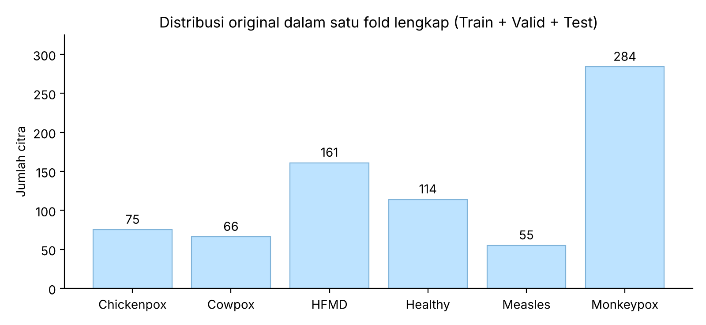
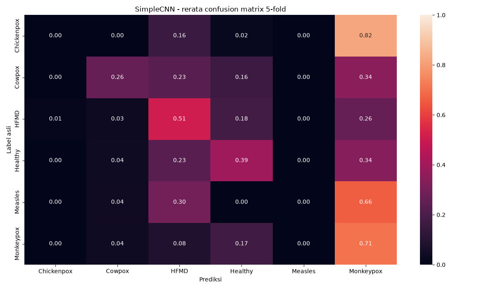
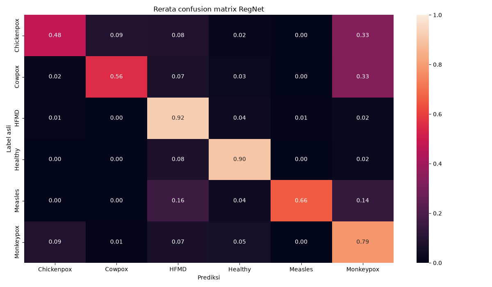
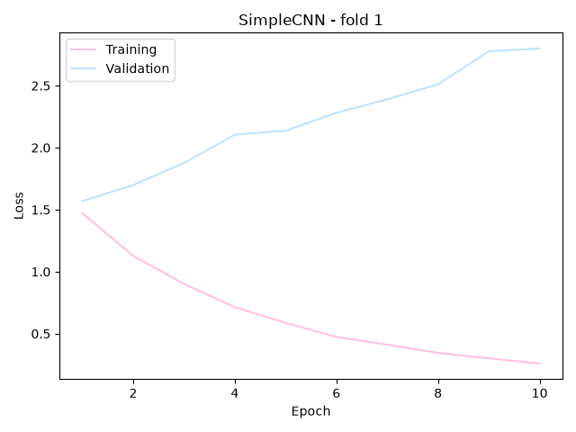
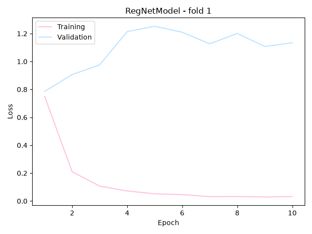

# Klasifikasi Citra Lesi Kulit dengan CNN dan RegNet


## Ringkasan

Studi kasus mata kuliah **Infrastruktur dan Platform untuk Sains Data** ini membandingkan CNN baseline dari materi, CNN modifikasi, dan RegNetY-400MF untuk membedakan enam kelas citra kulit. Dataset MSLD v2.0 berisi 755 citra asli. Setiap fold memakai pembagian Train, Valid, dan Test bawaan serta menyediakan 7.126–7.532 citra augmentasi untuk pelatihan. [Dataset MSLD v2.0](https://www.kaggle.com/datasets/joydippaul/mpox-skin-lesion-dataset-version-20-msld-v20/data)

| Model | Arsitektur | Parameter |
| --- | --- | ---: |
| CNN baseline | Dua blok Conv–ReLU–MaxPool, dengan 20 dan 50 filter ukuran 5 × 5, diikuti Flatten dan Linear. | 50.876 |
| CNN modifikasi | Tiga blok Conv–BatchNorm–ELU–MaxPool (32, 64, 128 filter ukuran 3 × 3), global average pooling, dan dua layer Linear dengan ELU dan dropout. | 110.758 |
| RegNetY-400MF | Backbone RegNetY pretrained ImageNet dengan layer klasifikasi akhir untuk enam kelas. | Sekitar 3,9 juta |

**Hasil lima fold tersedia untuk ketiga model.** Tabel merangkum evaluasi pada Original Test masing-masing fold. RegNetY-400MF memperoleh akurasi tertinggi pada kelima fold.

| Model | Accuracy | F1 weighted | ROC-AUC macro OvR |
| --- | ---: | ---: | ---: |
| CNN baseline | 49,37 ± 3,35% | 43,19 ± 4,26% | 0,7432 ± 0,0474 |
| CNN modifikasi | 51,97 ± 3,57% | 47,25 ± 4,52% | 0,7869 ± 0,0480 |
| RegNetY-400MF | 75,85 ± 5,80% | 75,11 ± 5,90% | 0,9335 ± 0,0110 |

Ketiga model dilatih dengan **Original Train + Augmented Train** sesuai ketentuan tugas. [Cara menjalankan kode](GUIDE.md)

## Tujuan dan alasan pemilihan model

Tujuan eksperimen adalah menilai kemampuan model membedakan Chickenpox, Cowpox, HFMD, Healthy, Measles, dan Monkeypox pada dataset yang ditentukan. CNN baseline menjadi pembanding terhadap implementasi materi. CNN modifikasi menguji kombinasi tiga blok konvolusi, BatchNorm, ELU, pooling global, dan dropout. RegNetY-400MF memberi pembanding berbasis transfer learning dengan backbone RegNet dan bobot pretrained ImageNet, dan layer klasifikasi terakhir diganti menjadi enam kelas. Model ini dipilih untuk menguji manfaat bobot pretrained pada dataset yang relatif kecil (755 citra original).

Perbandingan ini menilai konfigurasi eksperimen secara keseluruhan. Perbedaan hasil tidak dapat langsung dianggap sebagai pengaruh satu perubahan arsitektur karena ukuran input, batch size, lama training, strategi optimasi, dan inisialisasi bobot (RegNet pretrained, kedua CNN dilatih dari nol) juga berbeda.

## Dataset dan aturan pembagian

Data berasal dari [Mpox Skin Lesion Dataset v2.0 di Kaggle](https://www.kaggle.com/datasets/joydippaul/mpox-skin-lesion-dataset-version-20-msld-v20/data).

- Ketiga model dilatih menggunakan **Original Train + Augmented Train pada fold yang sama**.
- Validasi menggunakan **Original Valid** untuk memilih checkpoint dengan validation loss terendah.
- Pengujian menggunakan **Original Test** dari fold yang sesuai, setelah pemilihan checkpoint.
- Model dan optimizer diinisialisasi ulang untuk masing-masing dari lima fold. Setiap eksperimen memakai split bawaan dataset.
- Dataset, arsip dataset, dan bobot model tidak diunggah ke repositori.

### Karakteristik distribusi data pada setiap kelas

Hitungan diperoleh langsung dari folder lokal, bukan dari perkiraan. Dalam satu fold lengkap terdapat **755 citra original** pada gabungan Train, Valid, dan Test. Tabel menggunakan fold 1 sebagai acuan. Kelima fold memiliki total per kelas yang sama. Angka lima fold tidak dijumlahkan sebagai jumlah citra unik karena fold merupakan pembagian ulang koleksi yang sama.

| Kelas | Citra original dalam satu fold lengkap | Proporsi |
| --- | --- | --- |
| Chickenpox | 75 | 9,93% |
| Cowpox | 66 | 8,74% |
| HFMD | 161 | 21,32% |
| Healthy | 114 | 15,10% |
| Measles | 55 | 7,28% |
| Monkeypox | 284 | 37,62% |

Monkeypox merupakan kelas terbesar, sedangkan Measles paling sedikit. Datanya tidak seimbang. Jumlah file Augmented Train pada setiap kelas adalah 14 kali jumlah Original Train, sehingga distribusi proporsi kelas tetap tidak seimbang. Jumlah file juga bukan merupakan jumlah pasien.



| Fold | Original Train | Augmented Train | Train gabungan | Valid | Test |
| --- | --- | --- | --- | --- | --- |
| 1 | 537 | 7518 | 8055 | 144 | 74 |
| 2 | 509 | 7126 | 7635 | 164 | 82 |
| 3 | 538 | 7532 | 8070 | 153 | 64 |
| 4 | 524 | 7336 | 7860 | 150 | 81 |
| 5 | 538 | 7532 | 8070 | 154 | 63 |

Tabel lengkap per kelas dan split tersedia di [dataset_distribution.csv](results/dataset_distribution.csv). Penjumlahan Original dan Augmented Train mengikuti ketentuan tugas. Proyek menggunakan file augmentasi yang disediakan dataset.

### Preprocessing yang digunakan dan pengaruhnya terhadap hasil klasifikasi

Loader membaca citra dengan OpenCV, melakukan resize menjadi **100 × 100**, membagi intensitas dengan **255**, mengubah susunan kanal menjadi **CHW**, dan mengonversinya ke tensor `float32`. Di tingkat loader, urutan warna tetap **BGR** dan tidak ada normalisasi ImageNet. Setiap model menerapkan penyesuaian berikut di dalam `forward()`. [Kode loader](Utils/getData.py)

- **CNN baseline** menerima input 100 × 100 apa adanya.
- **CNN modifikasi** memperbesar tensor menjadi **160 × 160** dengan interpolasi bilinear.
- **RegNetY-400MF** mengubah urutan kanal **BGR → RGB** lalu menormalisasi dengan **mean/std ImageNet** agar sesuai dengan bobot pretrained. Input tetap 100 × 100.

Augmentasi tidak dibuat ulang di kode. Proyek memakai file **Augmented Images** bawaan dataset (± 14 kali jumlah Original Train per kelas) yang hanya digabungkan ke data training. Valid dan Test tetap memakai citra original.

Resize menyeragamkan dimensi input dan pembagian 255 menyetarakan skala intensitas, agar intensitas input berada pada rentang yang konsisten. Normalisasi ImageNet pada RegNet membuat distribusi input sesuai dengan data saat bobot pretrained dilatih. Augmentasi menambah variasi data training (7.126–7.532 file Augmented Train per fold), tetapi proporsi kelas tetap tidak seimbang karena setiap kelas diperbanyak dengan faktor yang sama. Detail lesi yang hilang ketika diperkecil ke 100 × 100 juga tidak kembali hanya dengan diperbesar ke 160 × 160, dan 100 × 100 jauh lebih kecil dari ukuran pretraining RegNet (224 × 224).

Tidak ada eksperimen ablation dengan model dan pengaturan identik, sehingga besar pengaruh setiap tahap preprocessing terhadap skor belum dapat diukur secara terpisah. Peningkatan CNN modifikasi tidak boleh diklaim semata-mata akibat resize, ELU, atau dropout, dan keunggulan RegNet tidak boleh diklaim semata-mata akibat normalisasi ImageNet.

### Kemampuan model untuk mengklasifikasi 6 kelas

RegNetY-400MF mengenali keenam kelas dengan recall rata-rata sekitar 48–92%. Recall tertingginya terdapat pada **HFMD (92%)** dan **Healthy (90%)**. Kedua CNN paling baik mengenali HFMD dan Monkeypox, tetapi masih kesulitan mengenali Chickenpox, Cowpox, dan Measles.

| Kelas | CNN baseline | CNN modifikasi (≈) | RegNetY-400MF (≈) |
| --- | ---: | ---: | ---: |
| Chickenpox | 11,43% | 19% | 48% |
| Cowpox | 35,22% | 7% | 56% |
| HFMD | 52,75% | 79% | 92% |
| Healthy | 34,24% | 39% | 90% |
| Measles | 5,00% | 8% | 66% |
| Monkeypox | 81,20% | 74% | 79% |

Setiap angka adalah rata-rata recall kelas pada lima fold. Untuk CNN baseline, jumlah prediksi benar per kelas diperoleh dari diagonal matriks tiap fold dan jumlah citra Test kelas tersebut. Untuk CNN modifikasi dan RegNet, nilai perkiraan mengikuti diagonal matriks rata-rata yang ditampilkan hingga dua desimal. [Matriks per fold CNN baseline](results/initial/cnn) · [Jumlah citra Test](results/dataset_distribution.csv) · [Matriks CNN modifikasi](results/initial/cnn_modified/confusion_matrix_mean.png) · [Matriks RegNet](results/initial/regnet/confusion_matrix_mean.png)

### Kelas yang paling sering mengalami kesalahan klasifikasi

- **CNN baseline.** Measles memiliki tingkat kesalahan rata-rata tertinggi (**95,00%**), disusul Chickenpox (**88,57%**). Sekitar 47% citra Measles dan 75% citra Chickenpox diprediksi sebagai Monkeypox jika proporsi tiap fold dirata-ratakan. Jika dihitung berdasarkan jumlah kemunculan di seluruh Test fold, HFMD menyumbang kesalahan terbanyak (**39 dari 82**), diikuti Chickenpox (**38 dari 42**).
- **CNN modifikasi.** Tingkat kesalahan tertinggi terdapat pada Cowpox (sekitar **93%**), Measles (sekitar **92%**), dan Chickenpox (sekitar **81%**). Sekitar 68% Cowpox dan 62% Chickenpox diprediksi sebagai Monkeypox, sedangkan sekitar 42% Measles diprediksi sebagai HFMD.
- **RegNetY-400MF.** Chickenpox paling sulit dikenali dengan tingkat kesalahan sekitar **52%**, diikuti Cowpox sekitar **44%**. Untuk masing-masing kelas tersebut, sekitar sepertiga citra diprediksi sebagai Monkeypox.

| CNN baseline | CNN modifikasi | RegNetY-400MF |
| --- | --- | --- |
|  |  |  |

### Hasil evaluasi pada masing-masing fold

| Model | Fold | Accuracy | Precision weighted | Recall weighted | F1 weighted | ROC-AUC macro OvR |
| --- | ---: | ---: | ---: | ---: | ---: | ---: |
| CNN baseline | 1 | 51,35% | 42,32% | 51,35% | 42,45% | 0,7606 |
| CNN baseline | 2 | 50,00% | 40,71% | 50,00% | 41,62% | 0,6790 |
| CNN baseline | 3 | 43,75% | 38,15% | 43,75% | 38,49% | 0,7082 |
| CNN baseline | 4 | 49,38% | 48,43% | 49,38% | 43,33% | 0,7843 |
| CNN baseline | 5 | 52,38% | 49,34% | 52,38% | 50,07% | 0,7838 |
| CNN modifikasi | 1 | 47,30% | 35,31% | 47,30% | 40,28% | 0,7980 |
| CNN modifikasi | 2 | 56,10% | 53,81% | 56,10% | 51,66% | 0,8370 |
| CNN modifikasi | 3 | 53,13% | 50,85% | 53,13% | 49,88% | 0,7565 |
| CNN modifikasi | 4 | 49,38% | 46,68% | 49,38% | 45,41% | 0,7205 |
| CNN modifikasi | 5 | 53,97% | 54,57% | 53,97% | 49,04% | 0,8222 |
| RegNetY-400MF | 1 | 74,32% | 76,72% | 74,32% | 73,55% | 0,9234 |
| RegNetY-400MF | 2 | 69,51% | 68,82% | 69,51% | 68,68% | 0,9207 |
| RegNetY-400MF | 3 | 81,25% | 81,95% | 81,25% | 80,82% | 0,9374 |
| RegNetY-400MF | 4 | 71,60% | 72,47% | 71,60% | 70,74% | 0,9396 |
| RegNetY-400MF | 5 | 82,54% | 84,87% | 82,54% | 81,74% | 0,9464 |

CNN baseline memperoleh akurasi tertinggi pada **fold 5 (52,38%)** dan terendah pada **fold 3 (43,75%)**. CNN modifikasi tertinggi pada **fold 2 (56,10%)** dan terendah pada **fold 1 (47,30%)**. RegNetY-400MF tertinggi pada fold 5 (82,54%) dan terendah pada fold 2 (69,51%). Setiap fold menguji 63–82 citra.

Ketiga CSV mencatat hasil evaluasi Original Test. Skrip `Test (RegNet).py` menulis CSV RegNet setelah memuat checkpoint setiap fold. [CSV CNN baseline](results/initial/cnn/metrics_5fold.csv) · [CSV CNN modifikasi](results/initial/cnn_modified/metrics_5fold.csv) · [CSV RegNet](results/initial/regnet/metrics_5fold.csv) · [Kode evaluasi RegNet](Test%20%28RegNet%29.py)

### Hasil rata-rata evaluasi dari kelima fold

| Model | Accuracy | Precision weighted | Recall weighted | F1 weighted | ROC-AUC macro OvR |
| --- | ---: | ---: | ---: | ---: | ---: |
| CNN baseline | 49,37 ± 3,35% | 43,79 ± 4,89% | 49,37 ± 3,35% | 43,19 ± 4,26% | 0,7432 ± 0,0474 |
| CNN modifikasi | 51,97 ± 3,57% | 48,24 ± 7,86% | 51,97 ± 3,57% | 47,25 ± 4,52% | 0,7869 ± 0,0480 |
| RegNetY-400MF | 75,85 ± 5,80% | 76,97 ± 6,60% | 75,85 ± 5,80% | 75,11 ± 5,90% | 0,9335 ± 0,0110 |

Nilai ditampilkan sebagai **rata-rata ± simpangan baku sampel** (`ddof=1`) dari lima fold. Setiap fold mendapat bobot yang sama. Berdasarkan angka CSV sebelum pembulatan, RegNet mengungguli CNN modifikasi sebesar **23,87 poin persentase** pada akurasi dan **27,85 poin persentase** pada F1 weighted. CNN modifikasi mengungguli CNN baseline sebesar 2,60 poin pada akurasi dan 4,06 poin pada F1 weighted.


### Kelebihan dan keterbatasan model yang dikembangkan

| Model | Kelebihan | Keterbatasan |
| --- | --- | --- |
| CNN baseline | Arsitektur dari materi sederhana dan hanya memiliki 50.876 parameter. | Recall Measles 5,00% dan Chickenpox 11,43%. Pada fold 1, training loss turun saat validation loss cenderung naik. |
| CNN modifikasi | Akurasi dan F1 weighted rata-rata lebih tinggi daripada baseline dengan tambahan BatchNorm, ELU, dropout, dan pooling global. | Recall Cowpox (± 7%) dan Measles (± 8%) masih sangat rendah; Measles sering tertukar dengan HFMD. |
| RegNetY-400MF | Memperoleh rata-rata tertinggi pada kelima metrik dan mengenali semua kelas. | Memiliki sekitar 3,9 juta parameter. Recall Chickenpox sekitar 48%. Perbedaan inisialisasi ImageNet dan pelatihan dari nol pada kedua CNN membatasi kesimpulan tentang pengaruh arsitektur. |

Ketidakseimbangan kelas dan ukuran Test per fold membatasi interpretasi skor. Pengujian menggunakan dataset MSLD v2.0 pada tingkat citra. Evaluasi per pasien dan validasi klinis pada dataset eksternal berada di luar eksperimen ini.

## Grafik training

| CNN baseline | CNN modifikasi | RegNetY-400MF |
| --- | --- | --- |
|  |  |  |

Grafik baseline fold 1 memperlihatkan training loss mendekati nol sementara validation loss cenderung meningkat. Karena itu, checkpoint yang dipakai untuk pengujian dipilih pada epoch dengan validation loss terendah.

## Struktur repositori

```text
Models/                 Arsitektur CNN baseline, CNN modifikasi, dan RegNet
Utils/                  Loader citra, konfigurasi, dan fungsi evaluasi
Train (*.py)            Pelatihan lima fold per model
Test (*.py)             Evaluasi Original Test per model
results/initial/        CSV dan grafik pada subfolder cnn, cnn_modified, dan regnet
results/                Distribusi dataset dan grafik perbandingan tiga model
scripts/                Pengumpulan dan pemeriksaan file hasil
GUIDE.md                Cara menjalankan pelatihan dan pengujian
requirements.txt        Dependensi Python
```

## Sumber dan atribusi

- Dokumen tugas W10 Studi Kasus Pembelajaran Mesin dan tujuh pertanyaan LMS menjadi dasar struktur laporan.
- CNN baseline mengikuti kode materi yang digunakan dalam proyek kelompok. CNN modifikasi diadaptasi dari notebook Rafa lalu disesuaikan menjadi tiga blok sebagaimana source lokal terakhir.
- [Dataset MSLD v2.0](https://www.kaggle.com/datasets/joydippaul/mpox-skin-lesion-dataset-version-20-msld-v20/data).
- [1] Radosavovic, I., Kosaraju, R. P., Girshick, R., He, K., & Dollár, P. (2020). [Designing Network Design Spaces](https://arxiv.org/abs/2003.13678). CVPR 2020. Implementasi memakai [torchvision `regnet_y_400mf`](https://docs.pytorch.org/vision/stable/models/generated/torchvision.models.regnet_y_400mf.html) dengan bobot `RegNet_Y_400MF_Weights.IMAGENET1K_V2`.
- [Dokumentasi ROC-AUC scikit-learn](https://scikit-learn.org/stable/modules/generated/sklearn.metrics.roc_auc_score.html).
